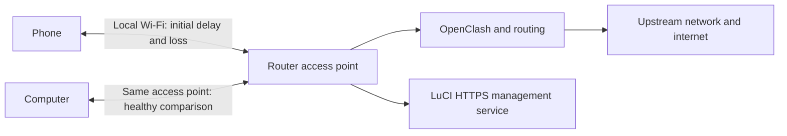
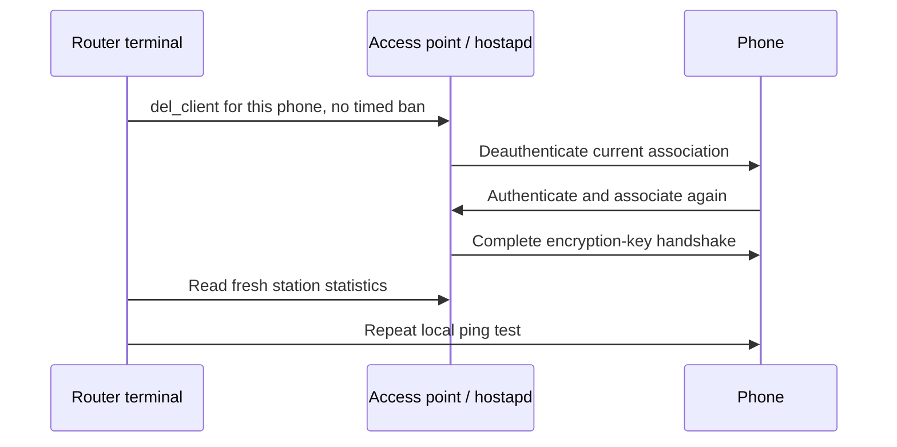
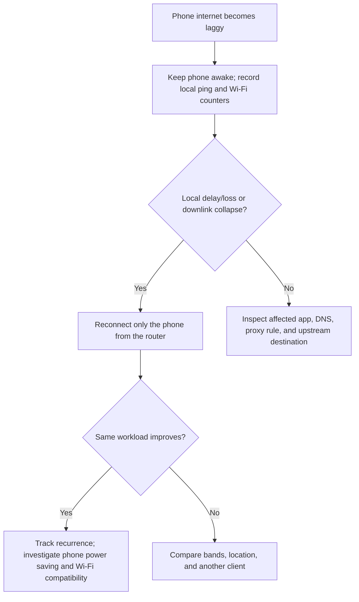

# Phone Wi-Fi lags while the computer is fast

**Diagnosed:** 2026-10-12. **Status:** Workaround verified; underlying cause unresolved.

**Device:** CMCC RAX3000M, MediaTek Filogic. **Firmware:** OpenWrt 25.12.5, r33051-f5dae5ece4; kernel 6.12.94.

**Affected client:** Rin's S26 Ultra, `192.168.39.183`, associated MAC address `5a:05:67:07:3c:44`.

## 1. Symptom

Internet access through OpenClash was fast on the computer (about 350 Mbps in the owner's earlier speed test), but slow and laggy on the phone. The owner reported that toggling Wi-Fi off and on on the phone did not reliably help. A router-side disconnect followed by automatic reconnection substantially improved measured Wi-Fi behavior, and the owner subsequently confirmed that internet performance felt much better.

The router's recently enabled HTTPS management service was initially suspected. No saved router settings were changed during diagnosis or recovery.

## 2. Evidence and possible cause

Both devices were connected to the same 5 GHz access point, on channel 36 with an 80 MHz channel width. Both had strong received signals, around −49 dBm. The computer's link rate was about 1,201 Mbps in both directions, while the router's transmit rate toward the phone was only 6–36 Mbps. The phone's transmit rate toward the router remained about 1,201 Mbps.

The phone's initial station statistics included 140,833 transmitted packets and 32,583 reported transmit failures. The computer had 812,868 transmitted packets and 452 failures. These are cumulative driver counters, not a controlled packet-loss measurement; compare counter changes over matching test periods when diagnosing a recurrence.

**Interpretation:** The local Wi-Fi link was the strongest immediate suspect. A ping from the router directly to the phone showed substantial delay and loss without involving the internet or OpenClash's proxy path. Reconnecting the association restored the reported downlink rate and eliminated loss in two subsequent samples.

**Unresolved:** A stuck association, driver/firmware interaction, or phone power-saving behavior could explain the symptoms. The session did not establish which was responsible. Screen-awake status was not independently confirmed, so the before/after samples were not a fully controlled experiment. Recovery after reconnection and the owner's improvement report support the workaround, but do not prove the underlying cause or long-term stability.



The router had about 95% idle CPU in the initial sample, around 248 MiB available memory, and 2,088 tracked network connections out of a limit of 31,232. Basic DNS lookups returned answers. OpenClash logged some destination-specific timeouts, but those do not explain loss on the direct router-to-phone ping.

**HTTPS finding:** `uhttpd` is the web server serving LuCI, the router's management interface. Enabling its HTTPS listener does not wrap all forwarded internet traffic in TLS. Its local HTTPS response completed in about 0.082 seconds, and no evidence implicated it in this incident. See [OpenWrt's uHTTPd documentation](https://openwrt.org/docs/guide-user/services/webserver/http.uhttpd).

## 3. Reconnect only the affected phone

This procedure briefly interrupts the selected phone's Wi-Fi connection. It removes its current access-point association, allowing a fresh authentication and encryption-key handshake. It does not reboot the router, restart OpenClash, reset Wi-Fi settings, or change saved configuration.

Use the phone's current IP and MAC address from LuCI's leases/client list. Phones may use different randomized MAC addresses for different networks. Interface names also vary; confirm the current interface before disconnecting anything.

**Computer terminal — connect to the router:**

```sh
ssh root@192.168.39.1
```

Enter the router password interactively. Credentials are intentionally excluded from this note.

**Router terminal — locate the client and access-point interface:**

```sh
cat /tmp/dhcp.leases
ip neigh show 192.168.39.183
iw dev
ubus list 'hostapd.*'
iw dev phy1-ap0 station get 5a:05:67:07:3c:44
```

The lease and neighbor entry should identify the phone's MAC address. `iw` inspects wireless interfaces and clients; the station query should return this phone's statistics. If it reports that the station is missing, locate its current interface rather than assuming `phy1-ap0` is correct.

**Router terminal — the exact reconnect command used in this incident:**

```sh
ubus call hostapd.phy1-ap0 del_client '{"addr":"5a:05:67:07:3c:44","reason":1,"deauth":true,"ban_time":0}'
```

`ubus` is OpenWrt's service communication interface. `hostapd` manages access-point client authentication. `del_client` disconnects the specified MAC address; `deauth: true` requests deauthentication, `reason: 1` supplies the unspecified reason code, and `ban_time: 0` adds no timed ban. This is documented in the [OpenWrt hostapd ubus method reference](https://git.openwrt.org/openwrt/staging/jow/tree/package/network/services/hostapd/README.md?h=a463bd8c99a23f8b78e3eaa7842acb9a15ebe90f).

The command returned without printed output. Router logs then confirmed disconnection, immediate reassociation, and a completed key handshake. Automatic reconnection depends on the phone's normal saved-network settings.



This forces cleanup from the access-point side. It may clear state that a phone-side Wi-Fi toggle does not reliably clear, but that mechanism remains a hypothesis here.

## 4. Test and verify performance

### Local latency and packet loss

Ping sends small probes and measures round-trip delay and missing replies. These tests isolate the local connection; they do not measure internet download speed. Keep the phone awake and reproduce the affected workload for a controlled repeat, then compare with an idle sample separately.

**Router terminal — test the router-to-phone path before and after reconnection:**

```sh
ping -c 15 -W 1 192.168.39.183
```

This sends 15 probes, with a one-second response timeout. The router's BusyBox ping rejected a fractional `-i 0.2` interval, so the actual measurements used the default interval with the command above.

**Computer terminal — compare the computer-to-router path:**

```sh
ping -c 15 -i 0.5 192.168.39.1
```

The computer's ping supported this half-second interval. This is a comparison from another client, not precisely the same test path or timing.

| Test actually performed | Replies | Reported loss | Average latency | Minimum / maximum |
|---|---:|---:|---:|---:|
| Router → phone, before reconnect | 11 / 15 | 26% | 256.058 ms | 66.905 / 591.130 ms |
| Computer → router | 15 / 15 | 0% | 3.614 ms | 0.611 / 17.380 ms |
| Router → phone, first test after reconnect | 15 / 15 | 0% | 5.874 ms | 1.393 / 31.616 ms |
| Router → phone, later 20-probe test | 20 / 20 | 0% | 63.685 ms | 2.443 / 209.644 ms |

The initial 4 missing replies out of 15 amount to about 26.7%; the router printed 26%. The later delay variation means reconnection did not establish consistently low latency under every condition.

**Router terminal — reproduce the later sample:**

```sh
ping -c 20 -W 1 192.168.39.183
```

### Wireless rates and failure counters

**Router terminal — inspect the phone's connection before and after each test:**

```sh
iw dev phy1-ap0 station get 5a:05:67:07:3c:44
```

Read `signal`, `tx bitrate`, `rx bitrate`, `tx packets`, `tx retries`, `tx failed`, and `connected time`. From the router's perspective, **tx** means router → phone and **rx** means phone → router. Signal is in dBm; a value around −49 indicates a strong signal in this incident.

After reconnecting, both reported link rates were 1,200.9 Mbps. At 46 seconds into the new association, counters showed 353,656 transmitted packets and 1,183 failures; the final check still showed 1,200.9 Mbps in both directions. Counters restarted with the new association, so raw totals cannot be directly compared across the reconnect.

**A Wi-Fi link rate is not application throughput.** Likewise, `expected throughput` is a driver estimate, not a speed-test result. No controlled post-reconnect internet speed-test number was captured by the diagnostic session; the owner confirmed a noticeable improvement afterward.

### Router health and HTTPS

**Router terminal — read-only checks used to rule out obvious resource exhaustion:**

```sh
ubus call system board
uptime
free
df -h
top -b -n 1 | head -25
cat /proc/sys/net/netfilter/nf_conntrack_count
cat /proc/sys/net/netfilter/nf_conntrack_max
nslookup www.google.com 127.0.0.1
nslookup www.baidu.com 127.0.0.1
uci show uhttpd
curl -s -o /dev/null --max-time 12 -w 'HTTPS web UI: %{http_code} %{time_total}s\n' -k https://192.168.39.1/
uci changes
```

Expected results include available memory, CPU headroom, connection usage below its limit, DNS answers, and a responding web interface. `uci changes` lists pending changes in OpenWrt's configuration system; it printed nothing at the end of this session. No configuration write commands were executed. The HTTPS probe used `-k` solely to accept the router's local certificate for this timing test.

## 5. If the problem returns

1. Record the phone's local ping, Wi-Fi rates, and counter changes while the phone is awake and actively reproducing the lag. Capture them before reconnecting.
2. Repeat the targeted router-side reconnect and compare the same workload. Record how long the improvement lasts.
3. Test near the router on 5 GHz with mobile data temporarily off. Compare a 2.4 GHz connection using the same internet speed-test server; this comparison was not performed in the incident.
4. Temporarily disable phone battery saving and, if available, Wi-Fi power saving under **Settings → Connections → Wi-Fi → Intelligent Wi-Fi**. Names and availability vary by software version. See [Samsung's connection-settings guide](https://www.samsung.com/us/support/answer/ANS10002546/).
5. If local Wi-Fi tests are healthy but particular apps still lag, inspect their DNS and OpenClash routing decisions. Compare domestic and proxied destinations. Investigate destination-specific timeouts separately.



Use this as a manual workaround while collecting evidence. A scheduled disconnect would interrupt sessions and hide recurrence patterns; none was configured. Firmware changes, power-saving changes, band comparisons, and a durable root-cause fix were not tested in this session.
